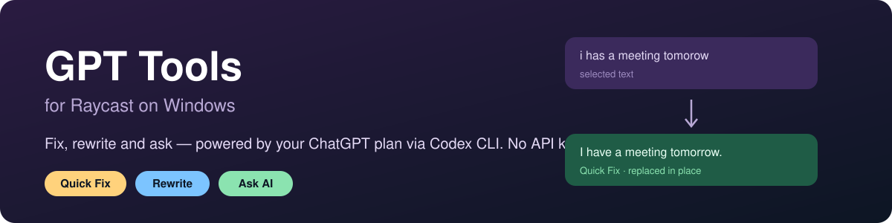
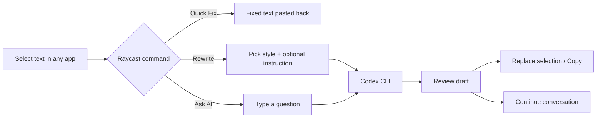
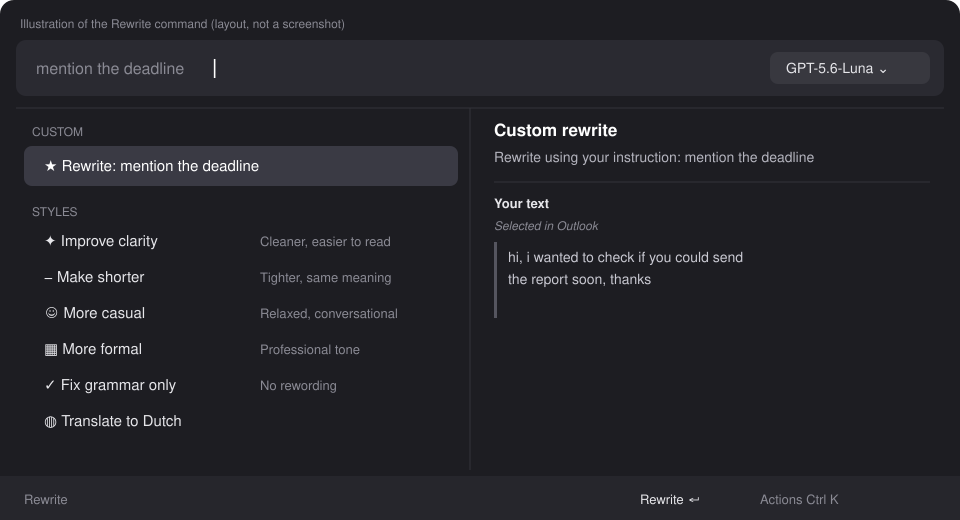
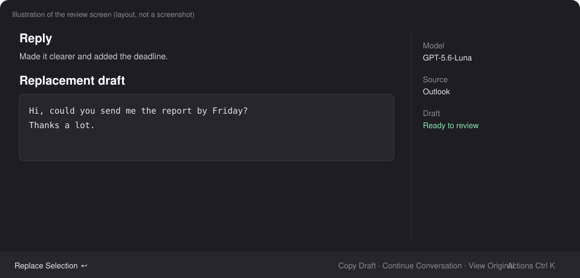

  
  
  
  

**Fix, rewrite and ask AI about any text in any app, from Raycast.** It runs through the official [Codex CLI](https://github.com/openai/codex) and your ChatGPT subscription sign-in, so there is **no API key and no pay-per-token billing**.

## Three commands

| Command | What it does | Typical use |
| --- | --- | --- |
| **Quick Fix** | Minimal spelling, grammar, capitalization and punctuation fixes, replaced in place | Select text → hotkey → done |
| **Rewrite** | Rewrites or translates in *your* voice, shows a draft to review, then replaces or copies | Emails, messages, documents |
| **Ask AI** | General chat, explain or summarize selected text, follow-up questions | "Explain this", "Summarize this" |

## Rewrite at a glance

Type an optional instruction in the search bar, pick a style, press **Enter**. Your selected text is shown in the side panel and the model picker sits at the top right.

Styles: **Improve clarity · Make shorter · More casual · More formal · Fix grammar only · Translate**, plus your own saved prompts.

## Review before anything changes

The reply and the replacement draft are kept separate, so nothing is pasted until you choose **Replace Selection**. **Continue Conversation** lets you refine ("shorter", "keep the second paragraph") with earlier turns remembered.

## Cheat sheet

| Want to… | Do this |
| --- | --- |
| Rewrite the selection | Open **Rewrite** → pick a style → **Enter** |
| Add a custom instruction | Type it in the search bar, press **Enter** on the first row (or on a style to add it to that style) |
| Rewrite pasted text | **Ctrl+K → Paste Text from Clipboard**, or **Edit Text** (Ctrl+E) |
| Switch model | Dropdown at the top right of the search bar |
| Translate | **Translate to …** row (language set in preferences) |
| Reuse a prompt | **Manage Saved Prompts** in **Ctrl+K**; they appear as rows |
| Fix a typo instantly | Bind a hotkey to **Quick Fix** in Raycast |

## Install (Windows, one double-click)

1. Install [Node.js 24 LTS](https://nodejs.org) and keep **Raycast** running.
2. Clone or download this repository.
3. Double-click **`Install.cmd`**. It will:
   - install the **Codex CLI** if it is missing,
   - open the **Sign in with ChatGPT** page if you are not logged in,
   - build the extension and load it into Raycast.
4. Search Raycast for **Rewrite**, **Quick Fix** or **Ask AI**. Keep the installer window open while you use the development extension.

Manual steps, troubleshooting and the first-test walkthrough are in [docs/DETAILS.md](docs/DETAILS.md).

## Privacy

Text is sent only to Codex, using your own ChatGPT sign-in. Nothing goes to any other server, and no API key is stored.

## License

[Apache License 2.0](LICENSE). See [NOTICE](NOTICE).
